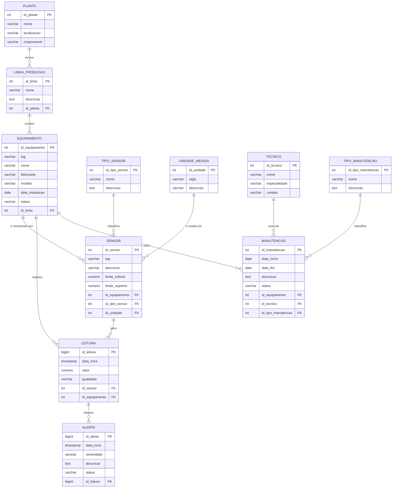

# Modelo conceitual (DER)

## Do que se trata

O SMI guarda as leituras dos sensores de uma indústria. Cada sensor está num
equipamento e tem um limite mínimo e um máximo. Quando uma leitura passa do
limite, o sistema registra um alerta. O banco também guarda as manutenções
feitas nos equipamentos e o técnico responsável por cada uma.

Para os dados de exemplo inventamos uma indústria com duas plantas em Minas
Gerais, com motores, bombas, compressores, fornos e um ventilador. Os sensores
medem temperatura, vibração, pressão, corrente e vazão.

## Base

O DER é o que o professor passou no enunciado, sem mudar entidade, atributo
nem relacionamento. São 11 entidades.

## Entidades

| Entidade | O que é |
|----------|---------|
| planta | Fábrica |
| linha_producao | Linha dentro de uma planta |
| equipamento | Máquina de uma linha |
| sensor | Instrumento que mede alguma coisa de um equipamento |
| tipo_sensor | Temperatura, vibração, pressão... |
| unidade_medida | °C, bar, A... |
| leitura | Uma medição de um sensor |
| alerta | Aviso de leitura fora do limite |
| manutencao | Serviço feito (ou agendado) em um equipamento |
| tipo_manutencao | Preventiva, corretiva, preditiva ou inspeção |
| tecnico | Quem faz a manutenção |

## Relacionamentos

Todos são 1:N (o "1" é a tabela de cima, o "N" a de baixo):

| 1 | N | Relacionamento |
|---|---|----------------|
| planta | linha_producao | possui |
| linha_producao | equipamento | contém |
| equipamento | sensor | é monitorado por |
| tipo_sensor | sensor | classifica |
| unidade_medida | sensor | é usada por |
| sensor | leitura | gera |
| equipamento | leitura | registra |
| leitura | alerta | dispara |
| equipamento | manutencao | sofre |
| tecnico | manutencao | executa |
| tipo_manutencao | manutencao | classifica |

Sobre o N:N que o enunciado menciona ("possibilidade de N:N"): no DER como
está, cada manutenção tem um técnico só. Se um dia for preciso mais de um
técnico por manutenção, a relação vira N:N e entra uma tabela no meio, algo
como `manutencao_tecnico (id_manutencao, id_tecnico)`. Deixamos fora porque o
DER do professor não tem.

## Diagrama

O Mermaid aparece desenhado direto no GitHub.

## Algumas decisões

- **Tipo dos valores:** `numeric(12,3)` e não `float`, porque a gente compara o
  valor com o limite e o `float` guarda aproximação.
- **Data e hora:** `timestamp` sem fuso, porque todos os sensores estão no
  mesmo fuso.
- **Status, severidade e qualidade:** são `varchar` com `CHECK` listando os
  valores permitidos. Pareceu exagero uma tabela para cada um.
- **Limites no sensor:** o limite fica em cada sensor e não no tipo de sensor,
  porque 90 °C é normal num forno e é muito para um motor.
