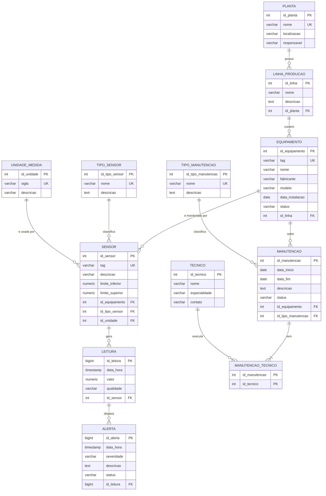

# Modelo conceitual (DER)

## O que o sistema faz

O SMI guarda as leituras dos sensores instalados nos equipamentos de uma
indústria, compara cada leitura com os limites do sensor e registra alertas
quando algum valor sai da faixa. O banco também controla as manutenções dos
equipamentos e quais técnicos participaram de cada uma.

O domínio escolhido é uma indústria fictícia com duas plantas em Minas Gerais,
com motores, bombas, compressores, fornos e um ventilador de exaustão. Os
sensores medem temperatura, vibração, pressão, corrente elétrica e vazão.

## Entidades

São 11 entidades vindas do DER de referência, mais uma tabela associativa
(`manutencao_tecnico`) que surgiu do relacionamento N:N. Total: 12 tabelas.

| Entidade | Papel no sistema |
|----------|------------------|
| `planta` | Unidade industrial (prédio/fábrica) |
| `linha_producao` | Linha dentro de uma planta |
| `equipamento` | Máquina instalada em uma linha |
| `sensor` | Instrumento de medição preso a um equipamento |
| `tipo_sensor` | Classificação do sensor (temperatura, vibração...) |
| `unidade_medida` | Unidade em que o sensor mede (°C, bar, A...) |
| `leitura` | Cada medição enviada por um sensor |
| `alerta` | Aviso gerado quando uma leitura sai dos limites |
| `manutencao` | Intervenção feita (ou agendada) em um equipamento |
| `tipo_manutencao` | Preventiva, corretiva, preditiva ou inspeção |
| `tecnico` | Pessoa que executa manutenções |
| `manutencao_tecnico` | Liga manutenção a técnico (N:N) |

## Relacionamentos

| Relacionamento | Cardinalidade | Leitura em voz alta |
|----------------|---------------|---------------------|
| planta **possui** linha_producao | 1:N | Uma planta tem várias linhas; cada linha é de uma planta |
| linha_producao **contém** equipamento | 1:N | Uma linha tem vários equipamentos |
| equipamento **é monitorado por** sensor | 1:N | Um equipamento pode ter vários sensores |
| tipo_sensor **classifica** sensor | 1:N | Cada sensor tem um tipo; um tipo vale para vários sensores |
| unidade_medida **é usada por** sensor | 1:N | Cada sensor mede em uma unidade |
| sensor **gera** leitura | 1:N | Um sensor gera muitas leituras ao longo do tempo |
| leitura **dispara** alerta | 1:N | Uma leitura fora do limite dispara alerta (na prática, 0 ou 1) |
| equipamento **sofre** manutencao | 1:N | Um equipamento passa por várias manutenções |
| tipo_manutencao **classifica** manutencao | 1:N | Cada manutenção tem um tipo |
| manutencao **é executada por** tecnico | **N:N** | Uma manutenção pode ter vários técnicos e um técnico faz várias manutenções |

O único N:N é manutenção/técnico. Ele é resolvido pela tabela
`manutencao_tecnico`, cuja chave primária é composta pelas duas chaves
estrangeiras.

## Diagrama

O diagrama abaixo está em Mermaid, então aparece desenhado direto no GitHub.

## O que mudou em relação ao DER de referência

Partimos do diagrama do enunciado e fizemos duas mudanças estruturais. As duas
são explicadas com mais calma em `03_modelo_logico_e_3fn.md`.

1. **`leitura.id_equipamento` saiu.** O DER de referência guarda o equipamento
   na leitura e também no sensor. Como cada sensor pertence a um único
   equipamento, o equipamento da leitura já é conhecido pelo `id_sensor`.
   Manter os dois permitiria dados contraditórios e quebra a 3FN.
2. **`manutencao.id_tecnico` virou a tabela `manutencao_tecnico`.** No
   original, cada manutenção tinha um técnico só. Em manutenção de verdade
   costuma ter mais de um, e o enunciado pede a possibilidade de N:N.

O resto (nomes de atributos, chaves, relacionamentos) segue o diagrama do
professor.

## Decisões de modelagem

- **Datas e horas:** `leitura.data_hora` e `alerta.data_hora` usam `timestamp`
  sem fuso, porque todos os sensores estão em Minas Gerais. Em um sistema com
  plantas em fusos diferentes o certo seria `timestamptz`.
- **Valores medidos:** `numeric(12,3)` em vez de `float`, para não ter erro de
  arredondamento na comparação com os limites (`valor > limite_superior`).
- **Estados (`status`, `severidade`, `qualidade`):** ficam em `varchar` com
  `CHECK` listando os valores permitidos. Uma tabela de domínio para cada um
  seria exagero para listas curtas e fixas.
- **Limites no sensor:** cada sensor tem seus próprios `limite_inferior` e
  `limite_superior`, porque o limite depende do equipamento e não só do tipo
  de sensor (uma temperatura de 90 °C é normal num forno e perigosa num motor).
